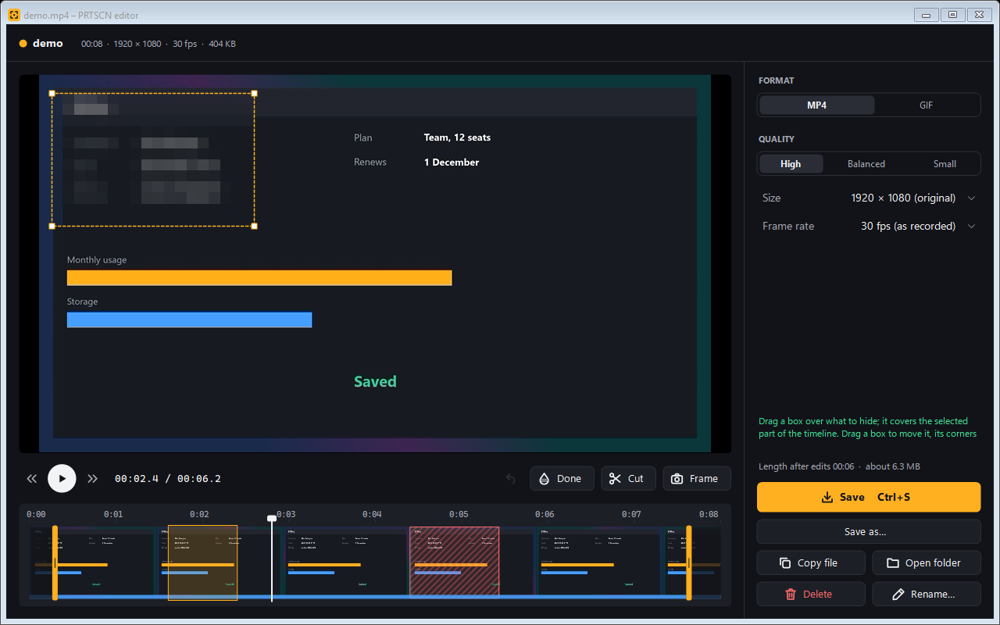
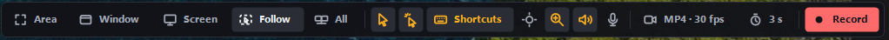
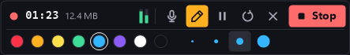
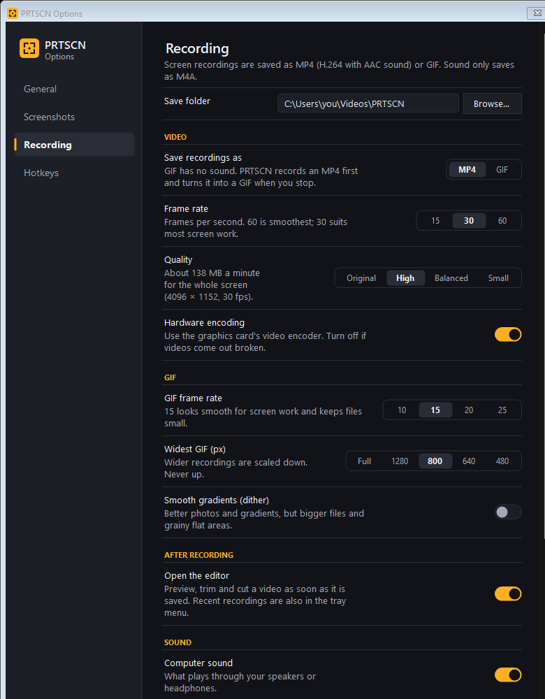
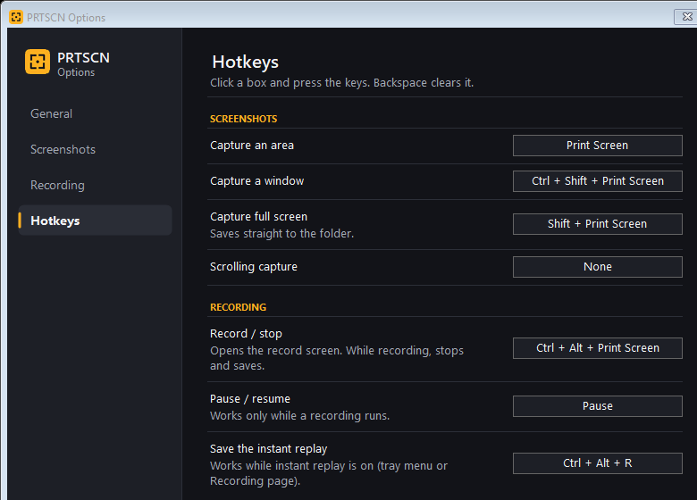

<p align="center">
  
</p>

<h1 align="center">PRTSCN</h1>

<p align="center">
  <b>Screenshots and screen recordings for Windows, in one small tray app.</b><br>
  Press Print Screen, drag a box, mark it up, done. Or record your screen, trim it, blur what's private, and save.
</p>

<p align="center">
  
  
  
  
  <a href="LICENSE"></a>
</p>

<p align="center">
  
</p>

---

## Why PRTSCN

Most screenshot tools stop at the picture, and most screen recorders are big apps with an account, a cloud and a subscription. PRTSCN does both jobs from the tray, stays out of your way, and keeps everything on your PC.

- **One keypress.** Print Screen freezes the screen, you drag a box, and a toolbar appears right next to it.
- **Nothing leaves your machine.** No account, no sign-in, no uploads. Files go to your Pictures and Videos folders.
- **Recording that respects privacy.** Blur a card number or an API key for exactly the seconds it's on screen, then save. The original file is never touched.
- **Made for tutorials.** Click ripples, pressed keys, a spotlight, a magnifier, zoom on clicks and drawing on the screen, all burned into the video and never shown on your desktop.
- **One self-contained exe.** Nothing to install. Copy it anywhere and run it.

## What it does

### Screenshots

| | |
| --- | --- |
| **Area** (Print Screen) | Drag a box on the frozen screen; a click takes the whole monitor |
| **Window** (Ctrl+Shift+Print Screen) | Hover highlights a window; a click captures it whole, even if it was half covered |
| **Full screen** (Shift+Print Screen) | Saves the monitor under the mouse straight to the folder |
| **Scrolling capture** | Scrolls a page or chat for you and stitches one long image |
| **Delayed capture** | 3, 5 or 10 seconds to open a menu first |
| **Mark it up** | Pen, line, arrow, rectangle, marker, blur, numbered steps and text, in 8 colours and any size |
| **Then** | Copy, save as PNG or JPG, or print |

### Screen recording

<p align="center"></p>

| | |
| --- | --- |
| **What to record** | An area, a window (follows it as it moves), a monitor, all monitors, or a fixed-size view that glides after the mouse |
| **Formats** | MP4 (H.264 + AAC) at 15, 30 or 60 fps, GIF, or sound only (M4A) |
| **Sound** | Computer sound and microphone, each with its own volume, with live level meters |
| **Effects** | Click highlights, pressed keys (shortcuts only, or all keys), spotlight, magnifier, zoom in on clicks |
| **Draw while recording** | Pen on the screen in 8 colours and any size; it lands in the video |
| **Watermark** | Your text and/or logo in a corner of every video |
| **Instant replay** | Keeps the last 30 s to 5 min in the background; Ctrl+Alt+R saves it |
| **Scheduled recordings** | Start at a time of day and stop after some minutes |
| **While recording** | Pause, restart, discard or stop from a small bar that never appears in the video |

<p align="center"></p>

### Video editor

A recording opens in the editor when you stop. Your original file is never changed: saving writes a new file next to it.

- **Trim** the start and end, and **cut** parts out of the middle (click a cut to put it back).
- **Blur** boxes over anything private. Drag them to move or resize, and drag the ends of their bar on the timeline to choose exactly when they show.
- **Save** as MP4 (quality, size, frame rate, sound), GIF (width, frame rate, dither) or sound only.
- **Frame** grabs the current frame as an image.
- Full **undo and redo**.

### Settings

<p align="center">
  
  
</p>

Every hotkey can be changed, and PRTSCN warns you when another app already owns one.

## Get started

1. Download `PRTSCN.exe` from the [Releases](../../releases) page.
2. Put it anywhere, for example `%LOCALAPPDATA%\PRTSCN\`, and run it. It lives in the tray.
3. On Windows 11, turn off *Settings > Accessibility > Keyboard > "Use the Print screen key to open screen capture"*, so Print Screen reaches PRTSCN. PRTSCN reminds you if it's on.
4. Only one app can own Print Screen, so quit other screenshot tools first.

The exe isn't code-signed yet, so Windows SmartScreen may warn the first time: choose **More info > Run anyway**.

**Needs:** Windows 10 version 2004 or later; tested on Windows 11.

## Default keys

| Key | Does |
| --- | --- |
| Print Screen | Capture an area |
| Ctrl+Shift+Print Screen | Capture a window |
| Shift+Print Screen | Save the full screen |
| Ctrl+Alt+Print Screen | Start recording; press again to stop and save |
| Pause | Pause or resume a recording |
| Ctrl+Alt+R | Save the instant replay |

The [user guide](docs/USAGE.md) lists every key, tool and option.

## Build from source

Needs the .NET 8 SDK or newer, on Windows.

```
dotnet test tests/PRTSCN.Core.Tests
dotnet run --project src/PRTSCN
dotnet publish src/PRTSCN -c Release -r win-x64 -o dist
```

The last command makes one self-contained `PRTSCN.exe` in `dist`.

Under the hood: WinForms for the UI, Windows.Graphics.Capture for screen capture, Direct2D for effects, Media Foundation for H.264/AAC encoding and decoding, and NAudio for sound. See the [user guide](docs/USAGE.md#build) for developer checks and the code layout.

## Credits

PRTSCN's screenshot flow is inspired by Lightshot. It is an independent project: no code, art or assets were taken from it.

## License

[MIT](LICENSE) © 2026 Giorgos Elef.
